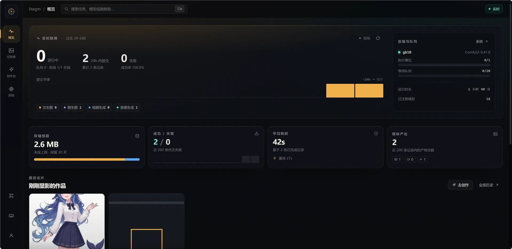
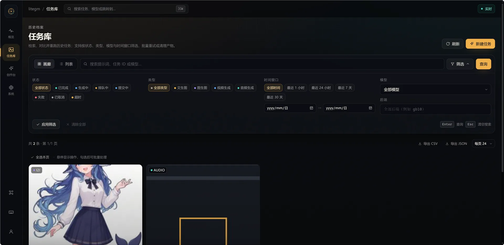
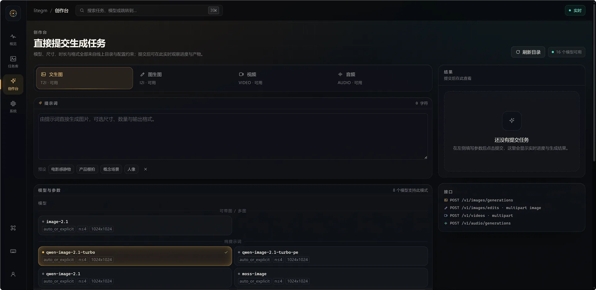
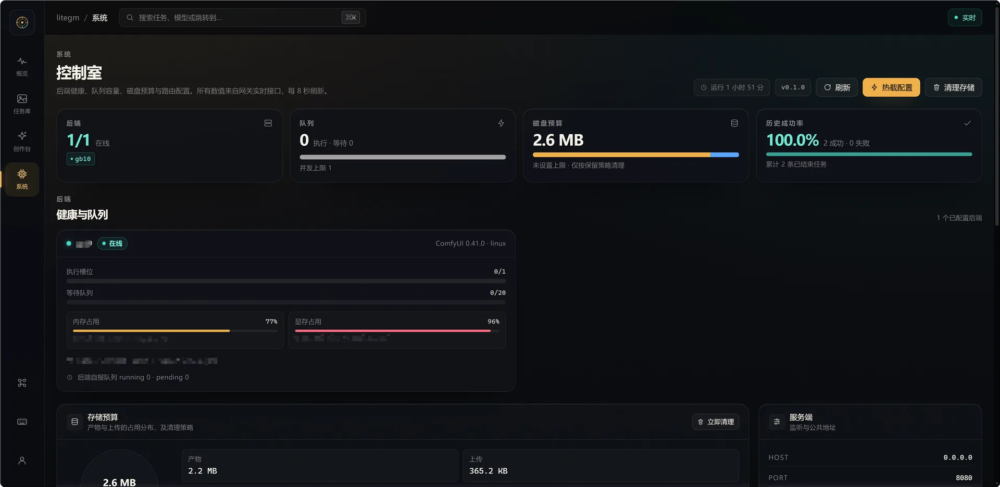

# litegm

把 **ComfyUI** 包装成 **OpenAI 兼容的多媒体生成网关**，并附带一个面向运维与创作者的
管理控制台。后端地址、workflow 模板、模型别名与参数映射全部由配置文件声明，网关代码
不包含任何针对某一台 ComfyUI 服务器的硬编码。

```
OpenAI SDK / curl  ──►  litegm 网关  ──►  ComfyUI 后端（一台或多台）
                         │  鉴权、路由、任务队列、产物治理
                         └─ 管理控制台 /admin（任务库、创作台、系统面板）
```

> 适用于自建 GPU 环境：所有模型、工作流与产物都留在你自己的机器上。

---

## 功能概览

### 生成接口（OpenAI 兼容）

| 能力 | 端点 | 说明 |
|---|---|---|
| 文生图 | `POST /v1/images/generations` | 字段与响应对齐 OpenAI 图像接口 |
| 图生图 / 编辑 | `POST /v1/images/edits` | multipart，多图输入，`<image1>`/`<image2>` 指代 |
| 统一图像入口 | `POST /v1/images` | 同一别名按是否带图自动路由到生成或编辑 |
| 视频生成 | `POST /v1/videos` → `GET /v1/videos/{id}` → `/content` | OpenAI 原生异步协议；文生/图生/参考生视频 |
| 音频生成 | `POST /v1/audio/generations` → `GET /v1/audio/{id}` → `/content` | 自定义异步扩展：音乐描述 + 歌词 |
| 模型清单 | `GET /v1/models` | 返回别名与能力（是否可带图、是否任务族等） |
| 签名下载 | `GET /v1/files/{id}` | `response_format=url` 时返回带过期时间的链接 |

- 兼容官方 OpenAI SDK：把 `base_url` 指向网关、`api_key` 设为 master key 即可。
- 视频支持**任务族**：以族名（如 `minimax-h3`）调用时，网关根据实际提供的输入字段
  路由到 t2v / i2v / r2v，并在响应中如实回显实际执行的变体。
- 图像接口为同步语义；超过 `server.sync_timeout_s` 返回 `504` 并带
  `X-Litegm-Task-Id`，任务继续执行，可用 `GET /v1/tasks/{id}` 取回。

### 管理控制台（`/admin`）

- **概览**：进行中/失败任务、24 小时提交分布、后端与队列状态、存储预算、最近出片、
  失败摘要（可一键重跑）。
- **任务库**：印片式画廊与密集表格双视图；按状态/类型/模型/后端/时间筛选与关键词搜索；
  批量重试、删除、导出 CSV/JSON。
- **任务详情**：产物大图与灯箱、输入图与产物的对照、请求参数、模型约束、执行时间线、
  workflow 快照与原始事件。
- **创作台**：按模型真实约束生成表单（画幅、尺寸步进、时长、数量、输出格式），
  拖拽上传参考图并指定角色，提交后实时查看进度与结果。
- **系统面板**：后端健康与队列、显存/内存、存储用量与保留策略、路由与模型表、
  配置热载、手动清理。
- 键盘优先：`Ctrl/Cmd+K` 命令面板、`g` 后接 `o/t/s/y` 跳转、`?` 查看快捷键。
- 深色"暗房"主题，窄屏自动切换为底部导航。

#### 界面截图

| 概览（实时脉搏、后端与队列、存储预算、最近出片） | 任务库（画廊/表格、筛选、导出、批量操作） |
|---|---|
|  |  |

| 创作台（按模型约束生成表单、实时进度与结果） | 系统（后端健康、队列、存储、配置热载） |
|---|---|
|  |  |

截图取自本机运行中的实例；其中的后端 id、模型别名与统计数字来自示例配置，以你自己的
`GET /v1/models` 与系统面板为准。

### 运维与安全

- 单用户名 + master key 鉴权；API 走 Bearer，管理台走 Basic 换取的签名会话 Cookie。
- 结构化访问日志、Prometheus 格式 `/metrics`、独立的 `/health/live` 与 `/health/ready`。
- 存储治理：产物保留天数、失败任务更长保留、磁盘上限与 LRU 清理、手动清理接口。
- 配置热载：`tasks`/`routing`/`backends` 可不重启生效，校验失败自动回滚。
- 任务级审计：实际提交的 workflow 快照、ComfyUI prompt id、阶段耗时、错误原文。

---

## 快速开始（本地）

前置：可用的 ComfyUI 后端，以及 [pixi](https://pixi.sh)（项目用它锁定 Python 3.15 环境）。
支持 Windows x86_64、Linux x86_64 与 Linux ARM64（`win-64`/`linux-64`/`linux-aarch64`
均已写入 `pixi.lock`）。

**配置文件约定**：仓库里的 `config/` 只是示例（会被提交到 git）；真实部署与本地测试都从
git 忽略的 `.config/` 目录读取配置。首次使用请先复制示例并修改：

```powershell
pixi install -e dev          # 服务端依赖 + 测试工具
pixi install -e web          # 前端构建工具（Node.js 22）

# 1) 准备真实配置目录（.config/ 已在 .gitignore 中，不会提交）
New-Item -ItemType Directory -Force .config | Out-Null
Copy-Item config/litegm.yaml .config/litegm.yaml

# 2) 按你的 ComfyUI 地址、workflow 与模型别名编辑 .config/litegm.yaml
$env:LITEGM_MASTER_KEY = "<你的 master key>"

pixi run check               # 用真实节点 schema 校验每个 workflow（会连接后端）
pixi run serve               # 读取 .config/litegm.yaml，默认监听 127.0.0.1:8080
```

- API 根地址：`http://127.0.0.1:8080/v1`
- 管理台：<http://127.0.0.1:8080/admin/>（用户名 `admin` + master key）
- 模板路径：示例配置里的 `config/workflows/...` 会解析到仓库自带的示例模板。要加自己的模型
  或使用仓库未收录的模板（例如 Z-Image 系），把模板放进 `.config/workflows/`，并在配置里写
  `.config/workflows/你的模板.json`。示例配置里没有的别名不会影响启动。

最小调用示例：

```python
from openai import OpenAI

client = OpenAI(api_key="<master key>", base_url="http://127.0.0.1:8080/v1")
r = client.images.generate(
    model="qwen-image-2.1-turbo",
    prompt="一只红色的狐狸坐在金色秋天的草地上，柔和晨光，浅景深",
    size="1024x1024",
)
```

编辑与视频：

```python
with open("person.png", "rb") as fh:
    r = client.images.edit(model="qwen-image-2.1-turbo", image=fh,
                           prompt="把 <image1> 的背景换成夕阳天空，主体保持不变")

job = client.videos.create(model="minimax-h3", prompt="清晨安静码头的长镜头", seconds=4)
# 轮询 client.videos.retrieve(job.id)，完成后 client.videos.download_content(job.id) 下载
```

---

## 部署

### Docker（推荐用于长期运行）

```powershell
# 1) 准备宿主机目录（都在 .gitignore 中，不会提交到 git）：
#    .env                 → LITEGM_MASTER_KEY=<你的 master key>
#    .config/litegm.yaml  → 你的真实配置（可先复制示例：Copy-Item config/litegm.yaml .config/）

# 2) 启动；真实配置与数据从宿主机挂载
docker compose up -d --build
```

- 端口：容器内与宿主机均为 `8080`（可在 `docker-compose.yml` 调整，需保持
  `server.public_base_url` 与实际对外地址一致）。
- 挂载：`./.config` → `/app/.config`（真实配置 `litegm.yaml` 与自定义 workflow），
  `./data` → `/app/data`（任务库、产物、上传文件）。容器读取 `/app/.config/litegm.yaml`；
  镜像里也带了示例 `config/`，供模板路径回退使用。
- 镜像分两阶段构建：Node 阶段产出管理台静态资源，pixi 阶段按 `pixi.lock` 安装运行时，
  以非 root 用户（UID 10001）运行，内置健康检查。运行时环境含 `ffmpeg`/`ffprobe`，
  视频产物的首帧缩略图在容器内直接可用。
- 若 Docker Hub / ghcr 拉取受限，可指定镜像加速器：

  ```powershell
  $env:NODE_IMAGE = "docker.m.daocloud.io/library/node:22-alpine"
  docker compose up -d --build
  ```

### 反向代理

网关本身不处理 TLS。生产环境建议置于 Nginx / Caddy 之后，并将 `server.public_base_url`
改为外部可访问的 HTTPS 地址，这样 `response_format=url` 返回的签名链接才可用。

---

## 配置要点

全部行为来自配置文件：仓库内的 `config/litegm.yaml` 是示例，实际运行读取 `.config/litegm.yaml`
（或 `--config` 指定的任意路径）。

| 段落 | 作用 |
|---|---|
| `server` | 监听地址、对外基础 URL、同步超时、管理台路径 |
| `auth` | 用户名与 master key（支持 `env:变量名`） |
| `storage` | 数据目录、产物保留、磁盘上限、清理周期 |
| `backends` | ComfyUI 地址、并发、超时、标签（可多台） |
| `routing` | 统一图像模型与视频任务族的路由规则 |
| `tasks` | 每个任务类型下的模型别名、workflow 模板、注入点、图片槽位、回退链、约束 |

增删模型、切换 workflow、调整尺寸与时长约束都只需改配置，无需改代码；改完可先
`pixi run check` 校验，再在系统面板"热载配置"。

仓库自带的示例配置包含文生图（Qwen Image 2.1 turbo/base、MOSS）、图像编辑、MiniMax H3
视频（t2v/i2v/r2v）与 Music3 音频。别名与能力请以 `GET /v1/models` 与你的配置为准。

示例配置只描述"模型与 workflow 的接线方式"，并不绑定某一台服务器：`backends[]` 默认指向
本机 ComfyUI（`http://127.0.0.1:8188`），把 `base_url` 改成你自己的实例地址即可；workflow
模板里引用的模型文件名（如 `qwen_image_2.1_turbo_int8_convrot.safetensors`）需与你的
ComfyUI 上实际安装的权重一致，不一致时改模板或改用你自己的导出文件。示例配置只收录了
通用性最好的几条 workflow；其余模型（例如 Z-Image 系）按同样的方式自行追加即可（模板放在
`.config/workflows/`，配置里用 `.config/workflows/...` 引用）。

---

## 文档

- [文档索引](docs/README.md) — 按读者分类的全部文档
- [使用说明](docs/usage.md) — 配置、启动、API 调用示例、运维功能、Docker
- [API 参考](docs/api.md) — 端点、字段、错误码
- [设计方案](docs/design.md) — 架构与关键机制的设计依据
- [开发者指南](docs/development.md) — 项目结构、模块索引、扩展指南
- [变更记录](docs/changelog/README.md) — 各里程碑实现与验证记录

面向 AI agent 的工作说明见 [AGENTS.md](AGENTS.md)。

---

## 已知限制

- 图像 `mask` 局部重绘尚未支持（返回 `unsupported_parameter`）。
- 长任务的进度为按阶段与耗时的估算值；ComfyUI `/ws` 的真实步级进度尚未接入。
- `n > 1` 的多图任务串行执行。
- 单用户鉴权，不含多租户、配额与计费。

## 免责声明

- **按"现状"提供**：本项目不附带任何明示或暗示的担保（包括但不限于适销性、特定用途
  适用性与不侵权担保）。使用本项目造成的任何直接、间接、特殊、附带或后果性损失，作者与
  贡献者均不承担责任。
- **生成内容由其调用方负责**：本网关只负责把请求转交给 ComfyUI 并保存产物；提示词、
  输入图片、生成结果的版权、内容合规、肖像权与商用许可，由使用方自行
  判断与承担。
- **模型与第三方许可**：workflow 模板中引用的模型权重（Qwen Image、MOSS、MiniMax H3 /
  Music3、Z-Image 等）、ComfyUI 自定义节点以及容器内的 ffmpeg 均有各自的许可证，请在使用
  与分发前确认符合你的场景；仓库只提供接线配置，不随附模型权重。
- **数据与隐私**：提示词、上传的输入图与生成产物都会落盘在 `data/`（含 SQLite 任务库与
  事件审计），默认保留 30 天；如涉及敏感内容，请调整 `storage` 配置并注意备份与清理。
- **无 SLA**：单用户鉴权、无多租户/配额/计费；生产环境请自行置于反向代理之后并做好监控与
  备份。

## 许可

本项目以 [Apache License 2.0](LICENSE) 发布。你可以自由使用、修改与分发（含商用），
需保留许可证与版权声明，并在修改的文件中注明改动；许可证不授予商标使用权。
